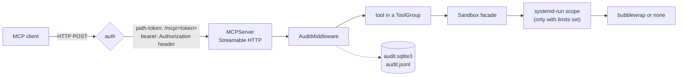

# Architecture

dev-link is one Python process per workspace. It serves the MCP Streamable HTTP endpoint and the
dashboard on one port, runs agent commands through a sandbox, and records every tool call.

## A tool call, end to end

1. **Auth.** With `path-token` (the default) the MCP endpoint is mounted at `/mcp/<token>`, so any
   other path gets 404 from the router. With `bearer` the endpoint is `/mcp` and the `BearerAuth`
   ASGI guard in `app.py` compares the `Authorization` header in constant time and answers 401.
   With `none` the endpoint is `/mcp` with no check (loopback only). The SDK's DNS-rebinding
   check on `Host` and `Origin` runs in every mode.
2. **MCP SDK.** `MCPServer` from the official `mcp` package handles the protocol and the
   Streamable HTTP transport. There is no stdio transport.
3. **AuditMiddleware** (`middleware.py`) wraps every `tools/call`: it records the arguments as a
   running event, awaits the tool, then stores the result text, error and duration. Client
   handshakes are recorded as session events.
4. **Tool.** Each tool belongs to a `ToolGroup` (`tools/base.py`). Groups get the shared
   `Runtime` (`runtime.py`): config, workspace, sandbox, audit store and process manager.
   Agent paths go through `Workspace.resolve` (`workspace.py`), which rejects paths outside the
   workspace while the sandbox is on.
5. **Sandbox facade** (`sandbox/__init__.py`) builds the environment, applies timeouts and output
   caps, and kills the whole process tree on timeout or cancellation.
6. **Backend** (`sandbox/backends/`) turns the command into the argv that runs it confined:
   `bubblewrap` on Linux, or `none`, which runs it as you. When `limits.memory_mb` or
   `limits.max_pids` is set, `sandbox/limits.py` puts the command in a transient
   `systemd-run --user --scope` with those limits.

Not every tool goes through the sandbox. The HTTP tools (httpx), the browser (Playwright
Chromium), checkpoints (host `git` against a separate repository) and docker (host `docker` CLI)
run in or from the server process on the host. Each applies its own checks; see
[security.md](security.md).

## Module map

Everything lives under `src/dev_link_mcp/`.

| Path | What it does |
| --- | --- |
| `cli/` | `dev-link` commands. `main.py` parses arguments and imports a command module only when it runs. `serve.py` has serve, start, stop, restart and status; `instance.py` the per-workspace lock, files and ports; `tunnel.py` the cloudflared child; `info.py` url, dashboard and logs; `doctor.py`, `config_cmd.py`, `tools_cmd.py` the rest. |
| `config/` | `models.py` holds every setting with its default and description; `loader.py` merges the layers; `schema.py` builds the JSON Schema. |
| `app.py` | Assembles the server: runtime, tool groups, dashboard routes, transport security, bearer guard, and the uvicorn loop with its shutdown order. |
| `middleware.py` | `AuditMiddleware`. |
| `audit.py` | `AuditStore` (SQLite plus JSONL mirror, redaction, retention prune) and the read-only `AuditReader` used by `dev-link logs audit`. |
| `live.py` | Fan-out of live messages to open dashboard tabs. |
| `sandbox/` | The `Sandbox` facade, the backends and resource limits. |
| `tools/` | Built-in tool groups, one module or package each, and `tools/__init__.py`, which loads built-ins and plugins and registers them. `tools/project/` is split into detection, test-output parsers and tool registration. |
| `processes.py` | `ProcessManager`: background processes, their log files and cleanup. |
| `runtime.py` | `Runtime`, the handles every group receives. |
| `workspace.py` | Path confinement and the `.dev-link` directory. |
| `web.py`, `browse.py` | Dashboard routes and the read-only file browser behind its Files tab. |
| `dashboard/` | The dashboard page, CSS and ES modules. |
| `private.py` | Opens files as 0600 before writing secrets into them. |

## Configuration

`config/loader.py` merges, lowest to highest: model defaults, the user file
(`$XDG_CONFIG_HOME/dev-link/config.yaml`), the `--config` file, `DEV_LINK_*` variables, then
command-line flags. It records which layer set each key, so errors and `dev-link config show`
can name it. `Config.finalize()` then resolves the workspace, generates the token when none is
pinned and creates the state dir. A config file inside the workspace is refused. Details are in
[configuration.md](configuration.md).

## Where state lives

Each workspace has a state dir, by default `$XDG_STATE_HOME/dev-link-mcp/<folder name>-<hash>`
(usually under `~/.local/state`), created with mode 0700 and never inside the workspace.

| File | Contents |
| --- | --- |
| `server.lock` | flock held by the running server, with its PID. |
| `connection.json` | MCP and dashboard URLs, workspace and PID (0600); removed on stop. |
| `server.log`, `tunnel.log` | Output of a background server and of cloudflared (0600). The banner in `server.log` contains the URLs with the token. |
| `audit.sqlite3`, `audit.jsonl` | Every event; the dashboard reads SQLite, the JSONL is for grep and log shippers. |
| `processes/` | One log file per background process. |
| `home/` | Private home directory mounted over your real home inside the sandbox. Persists between runs. |
| `tmp/` | Mounted as `/tmp` inside the sandbox; emptied at every start. |
| `tasks.json` | The agent's task list and notes. |
| `checkpoints.git` | The checkpoint repository, separate from the project's own `.git`. |

Inside the workspace, the server creates `.dev-link/` with a `.gitignore` of `*`. Screenshots
go to `.dev-link/artifacts/`.

## Lifecycle

`dev-link start` runs `python -m dev_link_mcp serve` in a new session, with output going to
`server.log`. It waits until `/health` answers and `connection.json` names that child's PID.
Without an explicit port it takes the first free one from 8765.

`serve` takes the lock and starts the tunnel first if `--tunnel` is set. Then
`Runtime.create` runs:

1. The sandbox is set up first, so a backend or limit that cannot work stops the start before
   anything else is opened. bubblewrap is probed with one throwaway sandbox.
2. The audit store opens, marks events left running by a crash as errors, and deletes events,
   JSONL lines and process logs older than `audit.retention_days` (default 30).
3. Tool groups are registered and the dashboard routes added. Then `connection.json` is
   written and uvicorn starts.

The browser group starts Chromium on first use and closes it after `idle_timeout_s` (default
300 s) without a browser call.

`dev-link stop` sends SIGTERM to the server's process group, and SIGKILL after 10 s. On the way
down the server stops the tunnel first, removes `connection.json`, kills every background
process, awaits each group's `shutdown()`, records a stop event and closes the audit store.

## Dashboard

The dashboard is static HTML, CSS and plain ES modules in `dashboard/`, with no build step and
no third-party code. The files are read once at startup and served from memory under
`/ui/<token>/` with a strict Content-Security-Policy. The page builds the DOM with
`textContent` only.

It reads these endpoints under `/ui/<token>/api/`:

| Endpoint | Used for |
| --- | --- |
| `info`, `tools` | Header chips, tool list with parameters. |
| `events`, `events/<id>`, `events/<id>/result` | Activity feed, event detail, large results in slices or as a download. |
| `stats` | Summary tiles, timeline and per-tool table. |
| `stream` | Server-sent events: new audit events, process and task changes, log growth. |
| `processes`, `processes/<id>/log`, `processes/<id>/stop` (POST) | Processes tab. |
| `tasks` | Tasks and notes tab. |
| `files`, `files/raw` | Read-only Files tab. `.git` internals and the state dir are never served. |

The page closes its event stream while its tab is hidden and catches up with `events?after=`
when it comes back. `/health` sits outside the secret path and returns only `{"status": "ok"}`.
