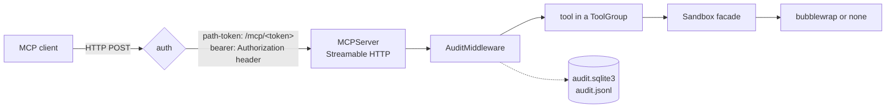

# Architecture

dev-link is one Python process per workspace. It serves the MCP Streamable HTTP endpoint and the
dashboard on one port, runs agent commands through a sandbox, and records every tool call.

## A tool call, end to end

1. **Auth** checks the token in the path, or the `Authorization` header with `bearer`.
2. **The MCP SDK** (`mcp` package) handles the protocol and the transport.
3. **AuditMiddleware** records each `tools/call` before it runs and its result after.
4. **The tool** gets the shared `Runtime`: config, workspace, sandbox, audit store, processes.
5. **The sandbox** runs commands under bubblewrap, with timeouts and output caps.

The HTTP tools, the browser, checkpoints and docker run in or from the server process instead of
the sandbox, each with its own checks; see [security.md](security.md).

## Code map

Everything lives under `src/dev_link_mcp/`.

| Path | What it does |
| --- | --- |
| `cli/` | The `dev-link` commands. |
| `config/` | Every setting with its default, and the merge of defaults, files, env and flags. |
| `app.py` | Assembles the server and runs it. |
| `sandbox/` | The sandbox facade, the bubblewrap and none backends, and resource limits. |
| `tools/` | The built-in tool groups, and the loader for plugin groups. |
| `audit.py`, `middleware.py` | The audit store and the middleware that writes to it. |
| `web.py`, `dashboard/` | The dashboard routes and its static page. |

## Where state lives

Each workspace has a state dir, by default `~/.local/state/dev-link-mcp/<folder>-<hash>`, never
inside the workspace. It holds the server lock and logs, the audit store, background process
logs, the sandbox's private home and `/tmp`, the task list and the checkpoint repository. Inside
the workspace the server only creates `.dev-link/`, which ignores itself in git.
